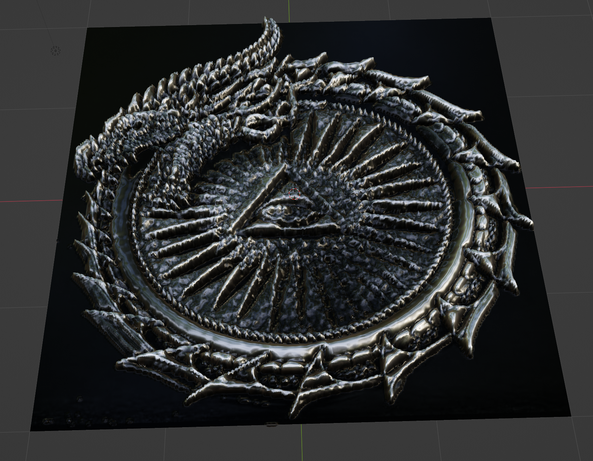
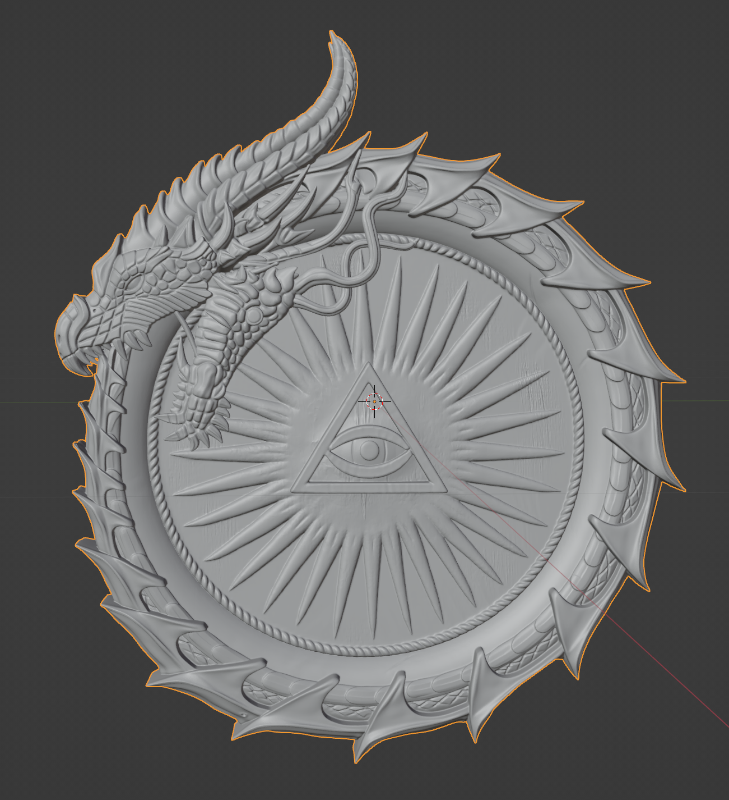

# Инструкция: Создание 3D-анимации серебряной монеты дракона для экрана iOS (Live Photo)

Полное практическое руководство по созданию анимированного видеоролика вращающейся серебряной монеты с Оком и драконом-уроборосом, мерцающим синим пламенем, и конвертации результата в **Live Photo** для экрана блокировки iPhone .

------

## 1. Стек технологий и окружение

- **ОС:** Windows 11 / PowerShell
- **3D-пакет:** Blender 3.6 LTS
- **Форматы данных:** `.OBJ` (3D-сетка), `.MP4` (видео H.264), `.MOV` (Apple ProRes 4444 с альфа-каналом)
- **Целевое устройство:** iOS 17 / 18 (Lock Screen Live Wallpaper)

------

## 2. Эволюция пайплайна: от 2D-картинки до честного 3D

1. **Попытка генерации через Heightmap + Displacement:**
   - Первоначально пробовали создать рельеф через карту высот из 2D-изображения (OpenCV `CLAHE` + Gaussian Blur + Blender Displacement) .
   - **Проблема:** органическая форма дракона (рога, зубы, поднутрения) вытягивалась в вертикальный «частокол», а боковая кромка рвалась.
     
2. **Переход на Image-to-3D AI генерацию:**
   - Сгенерирована полноценная замкнутая (watertight) двусторонняя модель монеты в сервисе Tripo3D / Hunyuan3D .
   - Модель экспортирована в формат **`dragon3d.obj`** и помещена в корень проекта .
     

------

## 3. Выравнивание геометрии и ориентация в пространстве

В Blender при импорте сторонних OBJ-файлов оси часто перепутаны (монета ложилась плашмя на бок).
Чтобы монета стояла вертикально в кадре:

- Выполнен поворот на **90° по оси X** (подъем из горизонтального положения в вертикальное).
- Выполнен поворот «циферблата» на **-90° по оси Z** (чтобы основание пирамидки Всевидящего Ока легло строго горизонтально, а острие смотрело вверх $\triangle$).
- Голова дракона заняла каноничное положение: **слева вверху**, направление взгляда — **против часовой стрелки**.

Для мгновенной отладки ориентации был написан быстрый скрипт проверки первого кадра `fast_preview.py` на движке **Workbench**, который рендерил тестовое превью за 1–2 секунды без шейдеров.

------

## 4. Материалы и свет в Blender EEVEE

## Шейдер античного серебра

- **Движок:** `Principled BSDF` .
- `Metallic = 1.0`, `Roughness = 0.18`.
- Микрорельеф чеканки реализован через связку `ShaderNodeTexNoise (Scale: 90)` $\rightarrow$ `ShaderNodeBump (Strength: 0.025)` в канал `Normal`.

## Магический синий огонь

- Источники света `POINT` (`Color: (0.05, 0.75, 1.0)`) привязаны через родительскую связь к самой монете (`parent = coin`) .
- Точки установлены:
  1. В центре Всевидящего Ока внутри пирамиды.
  2. В области глаз дракона.
- Анимация мерцания: процедурная синусоида силы света (`energy = base * (0.85 + 0.3 * sin(frame))`).

------

## 5. Итоговый Python-скрипт рендера (`render_dragon_final.py`)

Скрипт полностью автономен и запускается в фоновом режиме (headless) :

```python
import bpy
import math
from pathlib import Path

# 1. Очистка сцены
if bpy.context.object and bpy.context.object.mode != 'OBJECT':
    bpy.ops.object.mode_set(mode='OBJECT')
bpy.ops.object.select_all(action='SELECT')
bpy.ops.object.delete(use_global=False)

BASE_DIR = Path("dragon")
OBJ_PATH = BASE_DIR / "dragon3d.obj"
OUT_VIDEO = str(BASE_DIR / "dragon_coin_final.mp4")

# 2. Импорт и выравнивание
try:
    bpy.ops.wm.obj_import(filepath=str(OBJ_PATH))
except AttributeError:
    bpy.ops.import_scene.obj(filepath=str(OBJ_PATH))

coin = bpy.context.selected_objects[0]
coin.name = "DragonCoin"
bpy.context.view_layer.objects.active = coin
bpy.ops.object.origin_set(type='ORIGIN_GEOMETRY', center='BOUNDS')
coin.location = (0, 0, 0)

dim = max(coin.dimensions.x, coin.dimensions.y, coin.dimensions.z)
if dim > 0:
    coin.scale = (2.2 / dim, 2.2 / dim, 2.2 / dim)
    bpy.ops.object.transform_apply(location=False, rotation=False, scale=True)

# Ориентация: вертикально, пирамида вершиной строго вверх
coin.rotation_mode = 'XYZ'
coin.rotation_euler = (math.radians(90), 0, math.radians(-90))
bpy.ops.object.transform_apply(location=False, rotation=True, scale=False)
bpy.ops.object.shade_smooth()

# 3. Материал серебра
mat_silver = bpy.data.materials.new(name="Silver_Coin")
mat_silver.use_nodes = True
nodes = mat_silver.node_tree.nodes
links = mat_silver.node_tree.links
nodes.clear()

node_out = nodes.new('ShaderNodeOutputMaterial')
node_bsdf = nodes.new('ShaderNodeBsdfPrincipled')
node_bsdf.inputs['Base Color'].default_value = (0.82, 0.84, 0.88, 1.0)
node_bsdf.inputs['Metallic'].default_value = 1.0
node_bsdf.inputs['Roughness'].default_value = 0.18

node_noise = nodes.new('ShaderNodeTexNoise')
node_noise.inputs['Scale'].default_value = 90.0
node_noise.inputs['Detail'].default_value = 6.0

node_bump = nodes.new('ShaderNodeBump')
node_bump.inputs['Strength'].default_value = 0.025
node_bump.inputs['Distance'].default_value = 0.03

links.new(node_noise.outputs['Fac'], node_bump.inputs['Height'])
links.new(node_bump.outputs['Normal'], node_bsdf.inputs['Normal'])
links.new(node_bsdf.outputs['BSDF'], node_out.inputs['Surface'])

coin.data.materials.clear()
coin.data.materials.append(mat_silver)

# 4. Точечный синий огонь (Око + глаза дракона)
min_y = min(v.co.y for v in coin.data.vertices)
max_y = max(v.co.y for v in coin.data.vertices)
fire_lights = []

def add_coin_light(name, rel_pos, energy, color):
    ld = bpy.data.lights.new(name=name, type='POINT')
    ld.energy = energy
    ld.color = color
    ld.shadow_soft_size = 0.02
    lo = bpy.data.objects.new(name=name, object_data=ld)
    lo.location = rel_pos
    bpy.context.collection.objects.link(lo)
    lo.parent = coin
    return ld

for side, y_offset in [("Front", min_y * 1.06), ("Back", max_y * 1.06)]:
    l_eye = add_coin_light(f"Light_Eye_{side}", (0.0, y_offset, -0.08), 85.0, (0.05, 0.75, 1.0))
    fire_lights.append((l_eye, 85.0))
    l_drag = add_coin_light(f"Light_Drag_{side}", (-0.65, y_offset, 0.32), 65.0, (0.0, 0.55, 1.0))
    fire_lights.append((l_drag, 65.0))

# 5. Анимация (2 секунды, 30 FPS = 60 кадров, 360 градусов)
scene = bpy.context.scene
TOTAL_FRAMES = 60
scene.frame_start = 1
scene.frame_end = TOTAL_FRAMES
scene.render.fps = 30

bpy.ops.object.empty_add(type='PLAIN_AXES', location=(0, 0, 0))
rig = bpy.context.active_object
rig.name = "CoinRig"
rig.rotation_euler = (math.radians(8), 0, 0)
coin.parent = rig

coin.rotation_mode = 'XYZ'
coin.rotation_euler = (0, 0, 0)
coin.keyframe_insert(data_path="rotation_euler", frame=1)
coin.rotation_euler = (0, 0, math.radians(-360))
coin.keyframe_insert(data_path="rotation_euler", frame=TOTAL_FRAMES + 1)

if coin.animation_data and coin.animation_data.action:
    for fc in coin.animation_data.action.fcurves:
        for kp in fc.keyframe_points:
            kp.interpolation = 'LINEAR'

for light_data, base_energy in fire_lights:
    for f in range(1, TOTAL_FRAMES + 1, 4):
        pulse = base_energy * (0.85 + 0.3 * math.sin(f * 0.9))
        light_data.energy = pulse
        light_data.keyframe_insert(data_path="energy", frame=f)

# 6. Камера и освещение
cam_data = bpy.data.cameras.new("MainCam")
cam_obj = bpy.data.objects.new("MainCam", cam_data)
bpy.context.collection.objects.link(cam_obj)
scene.camera = cam_obj
cam_obj.location = (0, -4.5, 0.1)
cam_obj.rotation_euler = (math.radians(88), 0, 0)

def add_studio_light(name, pos, energy, color):
    ld = bpy.data.lights.new(name, type='POINT')
    ld.energy = energy
    ld.color = color
    lo = bpy.data.objects.new(name, ld)
    lo.location = pos
    bpy.context.collection.objects.link(lo)

add_studio_light("KeyFront", (2.8, -3.8, 2.2), 340, (1.0, 0.98, 0.95))
add_studio_light("FillFront", (-2.8, -3.8, -1.0), 180, (0.85, 0.92, 1.0))
add_studio_light("RimBack", (0.0, 3.8, 1.6), 420, (0.1, 0.6, 1.0))

# 7. Настройки рендера (вертикальный формат 9:16)
scene.render.engine = 'BLENDER_EEVEE'
if hasattr(scene.eevee, 'use_bloom'):
    scene.eevee.use_bloom = True
    scene.eevee.bloom_threshold = 0.92
    scene.eevee.bloom_intensity = 0.08

scene.render.resolution_x = 720
scene.render.resolution_y = 1280
scene.eevee.taa_render_samples = 16

if not scene.world:
    scene.world = bpy.data.worlds.new("World")
scene.world.color = (0.008, 0.008, 0.012)

scene.render.filepath = OUT_VIDEO
scene.render.image_settings.file_format = 'FFMPEG'
scene.render.ffmpeg.format = 'MPEG4'
scene.render.ffmpeg.codec = 'H264'
scene.render.ffmpeg.constant_rate_factor = 'MEDIUM'
scene.render.ffmpeg.ffmpeg_preset = 'REALTIME'
scene.render.image_settings.color_mode = 'RGB'

print("[*] Рендер монеты...")
bpy.ops.render.render(animation=True)
print(f"[+] Готово: {OUT_VIDEO}")
```

------

## 6. Запуск сборки видео

В консоли **PowerShell**:

```powershell
& "blender.exe" -b -P "render_dragon_final.py"
```

Рендер занимает **около 25 секунд** и создает файл `dragon_coin_final.mp4` весом **около 2 МБ** .

------

## 7. Экспорт на iPhone и установка Live Photo на экран блокировки

1. **Передача:** отправить `dragon_coin_final.mp4` себе в Telegram (в «Избранное») $\rightarrow$ нажать *«Поделиться»* $\rightarrow$ *«Сохранить видео»* (Camera Roll) .
2. **Конвертация в Live Photo:**
   - Открыть приложение **intoLive** (или системный шорткат iOS *Create Live Photo from Video*) .
   - Загрузить видео, выбрать обложку (Key Photo — 1-й кадр) $\rightarrow$ сохранить как Live Photo .
3. **Установка на обои:**
   - Зажать пальцем экран блокировки $\rightarrow$ нажать **«+»** $\rightarrow$ выбрать фильтр **Live Photo** .
   - Убедиться, что значок Live Photo внизу слева активен .
   - Нажать **«Добавить»** . При включении экрана монета бесшовно вращается на 360° с синим сиянием глаз дракона и Ока .